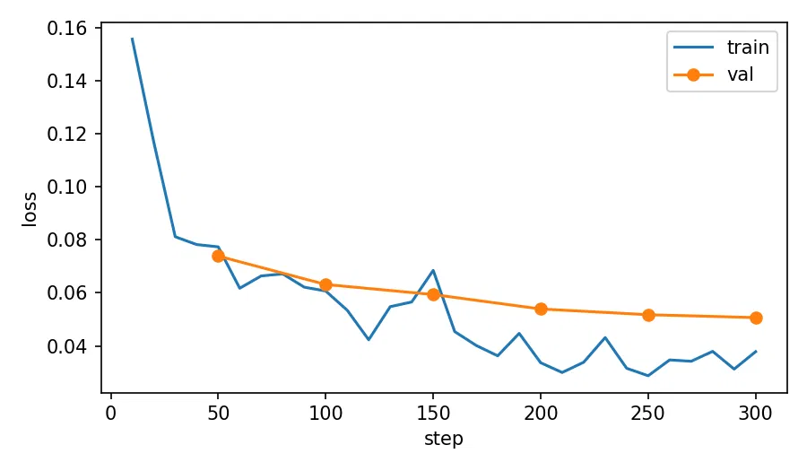

# Análise de sentimento por aspecto em português com QLoRA

[](https://huggingface.co/thiag8ito/qwen2.5-1.5b-aspectos-ecommerce-ptbr-qlora)
[](LICENSE)


Fine-tuning de um LLM pequeno (**Qwen2.5-1.5B-Instruct**, 4-bit, **QLoRA**) para ler uma avaliação de cliente em português e devolver o sentimento por aspecto em JSON:

```
"Produto ótimo, mas o pedido atrasou 10 dias e ninguém respondeu."
→ {"produto":"positivo","entrega":"negativo","atendimento":"negativo"}
```

## Resumo

- **Tarefa:** classificar `produto`, `entrega` e `atendimento` em `positivo`, `negativo`, `neutro` ou `ausente`, em avaliações de e-commerce (Olist).
- **Resultado:** o QLoRA leva o **F1 macro médio de 0.472 (zero-shot) para 0.691** e o **exact match de 0.267 para 0.733**, supera o baseline TF-IDF + Regressão Logística (0.587 e 0.487) e passa a devolver **JSON válido em 100%** dos casos (96% no zero-shot). Teste de 300 avaliações com rótulo humano.
- **Metodologia:** rótulos de treino *silver* gerados por um LLM maior (Qwen2.5-7B-Instruct, 4-bit, no próprio Colab), teste revisado por humano, baselines justos (mesmo prompt) e análise de erros.
- **Custo:** treino em GPU T4 gratuita do Colab; o adaptador publicado tem poucos MB.

| Modelo | F1 macro médio | Exact match |
|---|---|---|
| Qwen2.5-1.5B zero-shot | 0.472 | 0.267 |
| TF-IDF + LogReg | 0.587 | 0.487 |
| **Qwen2.5-1.5B + QLoRA** | **0.691** | **0.733** |

## Conteúdo do repositório

```
notebooks/   01_preparar_dados_colab, 02_qlora_avaliacao_publicacao_colab, 03_analise_de_erros_colab
results/     metricas.csv, loss_curve.png, erros_modelo.csv
docs/        analise_de_erros.md, model_card_hf.md
```

- 🤗 **Adaptador:** [`thiag8ito/qwen2.5-1.5b-aspectos-ecommerce-ptbr-qlora`](https://huggingface.co/thiag8ito/qwen2.5-1.5b-aspectos-ecommerce-ptbr-qlora)
- 🔍 **Análise de erros completa:** [`docs/analise_de_erros.md`](docs/analise_de_erros.md)
- 📄 **Model card:** [`docs/model_card_hf.md`](docs/model_card_hf.md)

## Uso rápido

```python
import torch
from peft import PeftModel
from transformers import AutoModelForCausalLM, AutoTokenizer, BitsAndBytesConfig

base = "Qwen/Qwen2.5-1.5B-Instruct"
tok = AutoTokenizer.from_pretrained(base)
bnb = BitsAndBytesConfig(load_in_4bit=True, bnb_4bit_quant_type="nf4", bnb_4bit_compute_dtype=torch.float16)
model = AutoModelForCausalLM.from_pretrained(base, quantization_config=bnb, device_map="auto")
model = PeftModel.from_pretrained(model, "thiag8ito/qwen2.5-1.5b-aspectos-ecommerce-ptbr-qlora")
```

O prompt de sistema precisa ser **o mesmo usado no treino**; ele está completo no [model card](docs/model_card_hf.md), junto com o exemplo de geração.

## Pipeline

1. **Dados:** Olist, texto de 25–400 caracteres, deduplicado, amostra balanceada por nota (~3.000).
2. **Rótulos silver:** Qwen2.5-7B-Instruct em 4-bit rodando no Colab, uma avaliação por pedido, guia de anotação fixo com 4 exemplos few-shot e decodificação determinística (sem amostragem).
3. **Teste gold:** 300 avaliações separadas e **revisadas por humano** (300 de 300 linhas revisadas, ~10% alteradas em relação ao LLM). Concordância LLM × humano (kappa de Cohen): produto 0.84, entrega 0.88, atendimento 0.78. Indica a qualidade dos rótulos silver usados no treino. Regras de decisão na seção [Guia de anotação](#guia-de-anotação).
4. **Baselines:** (a) o próprio Qwen zero-shot, (b) TF-IDF + Regressão Logística.
5. **QLoRA:** NF4 + LoRA r=16 em todas as projeções, loss só na resposta, 2 épocas.
6. **Avaliação, análise de erros e publicação** com model card gerado a partir das métricas reais.

## Guia de anotação

Cada aspecto é julgado separadamente, **apenas pelo texto** (a nota da avaliação não é usada). Valores: `positivo`, `negativo`, `neutro`, `ausente`.

| Aspecto | Inclui |
|---|---|
| `produto` | qualidade, defeito, funcionamento, tamanho, fidelidade à foto/descrição, item errado ou faltando |
| `entrega` | prazo, atraso, rastreamento, item que não chegou, embalagem danificada no transporte |
| `atendimento` | resposta do vendedor/loja, SAC, troca, devolução, reembolso, comunicação |

| Valor | Quando usar |
|---|---|
| `ausente` | O texto não trata do aspecto. Não se infere o que não foi dito. |
| `neutro` | Há menção sem polaridade clara ou com avaliação equilibrada ("produto ok, nada demais"). |
| `positivo` / `negativo` | Polaridade explícita ou claramente implícita ("não chegou" → `entrega=negativo`). |

**Casos de borda e decisão adotada**

- Produto errado recebido → `produto=negativo`.
- "Loja resolveu rápido" → `atendimento=positivo`.
- "Recomendo a loja" genérico, sem citar atendimento → `atendimento=ausente`.
- Avaliação mista ("produto bom, mas atrasou") → um rótulo por aspecto, não o mesmo para todos.
- Ironia ("Parabéns, só demorou 3 meses") → rotulado pelo sentido real (`entrega=negativo`).

> **Inconsistências conhecidas:** na revisão, elogios genéricos ("tudo transcorreu bem") e itens não recebidos ("não recebi o produto") ficaram rotulados de formas diferentes entre avaliações. Detalhes e impacto nas métricas em [`docs/analise_de_erros.md`](docs/analise_de_erros.md).

**Processo:** rótulos silver gerados por LLM com este mesmo guia (few-shot, decodificação determinística); depois, revisão manual das linhas do teste, corrigindo o que divergia do guia. Erros recorrentes do LLM observados na revisão: marcar `ausente` quando o aspecto está implícito, confundir `neutro` com `ausente`, ignorar ironia.

## Resultados (conjunto de teste, n=300, rótulo humano)

| Modelo | JSON válido | F1 macro médio | Exact match | F1 menção |
|---|---|---|---|---|
| Qwen2.5-1.5B zero-shot | 0.96 | 0.472 | 0.267 | 0.758 |
| TF-IDF + LogReg | 1.00 | 0.587 | 0.487 | 0.838 |
| **Qwen2.5-1.5B + QLoRA** | **1.00** | **0.691** | **0.733** | **0.923** |

F1 macro e acurácia por aspecto:

| Modelo | F1 produto | F1 entrega | F1 atendimento | Acc produto | Acc entrega | Acc atendimento |
|---|---|---|---|---|---|---|
| Qwen2.5-1.5B zero-shot | 0.575 | 0.522 | 0.319 | 0.693 | 0.680 | 0.480 |
| TF-IDF + LogReg | 0.690 | 0.604 | 0.466 | 0.767 | 0.803 | 0.740 |
| **Qwen2.5-1.5B + QLoRA** | **0.805** | **0.689** | **0.577** | **0.877** | **0.913** | **0.887** |

Métricas completas em [`results/metricas.csv`](results/metricas.csv). Com 300 exemplos, diferenças pequenas entre modelos devem ser lidas com cautela: não foram calculados intervalos de confiança.

**Leitura:** o QLoRA sobe o F1 macro médio de 0.472 para 0.691 em relação ao zero-shot e supera o TF-IDF em 0.104 de F1 macro e 0.246 de exact match; além disso, a saída passa a ser sempre um JSON válido. `atendimento` é o aspecto mais difícil: a acurácia é alta (0.887), mas o F1 macro é bem menor (0.577). A [análise de erros](docs/analise_de_erros.md) mostra que 24 dos 34 erros nesse aspecto são menções não detectadas (o modelo previu `ausente`).



**Curva de loss:** a loss de validação cai de 0.074 (passo 50) para 0.051 (passo 300) sem voltar a subir, e a de treino fica um pouco abaixo (cerca de 0.03 a 0.04), sem sinal claro de overfitting em 2 épocas. A loss é medida só nos tokens da resposta, boa parte deles o esqueleto fixo do JSON, então valores baixos não equivalem a acurácia alta; o que mede a qualidade é o F1 no teste.

### Principais achados dos erros

O modelo errou 97 pares avaliação × aspecto em 80 das 300 avaliações. Metade dos erros (49) é **menção perdida** (o modelo prevê `ausente` onde o humano marcou o aspecto), e a polaridade invertida é rara (8). Parte relevante dos erros vem de **inconsistência do gabarito** (itens não recebidos e elogios genéricos). Análise completa, com exemplos: [`docs/analise_de_erros.md`](docs/analise_de_erros.md).

## Decisões e trade-offs

- **Gerativo em vez de cabeça de classificação:** saída estruturada, fácil de estender para novos aspectos sem mudar a arquitetura. O custo é inferência mais lenta que um BERT; por isso o TF-IDF entra como referência de custo-benefício.
- **Loss mascarada no prompt:** o gradiente só vem da resposta, o que acelera a convergência e evita decorar o prompt.
- **fp16 e não bf16:** a T4 não suporta bf16.
- **Rótulos silver + teste humano:** treinar com anotação barata e avaliar com anotação cara é um desenho comum em produção.
- **Mesmo prompt no baseline e no ajustado:** comparação justa. O ganho vem do fine-tuning, não de um prompt melhor.

## Limitações

- Rótulos de treino herdam vieses do LLM anotador.
- Domínio é e-commerce (2016–2018), não delivery de comida; para outro domínio é preciso reajustar com dados próprios.
- A classe `neutro` é rara, então as métricas nela têm alta variância.
- Teste de 300 exemplos, anotado por uma pessoa, sem concordância humano × humano medida e sem intervalos de confiança.
- Sem calibração de confiança.

## Próximos passos

- Intervalos de confiança por bootstrap nas métricas.
- Corrigir o guia de anotação nos casos de borda e re-rotular treino e teste.
- Few-shot e prompt engineering como baseline mais forte; ablação de `r` (8/16/32) e de 0.5B vs 1.5B.
- Calibração e abstenção com baixa confiança.
- Servir com vLLM (ou mesclar o adaptador) e medir latência e custo por mil avaliações; monitoramento de drift.

## Como rodar

Todo o projeto roda no **Google Colab** com GPU T4 (gratuita ou com unidades de computação), sem GPU local e **sem chave de API**. Os rótulos são gerados por um modelo aberto (Qwen2.5-7B-Instruct) dentro do próprio Colab. Os notebooks são executados em ordem e trocam dados pelo arquivo `data.zip`.

**Pré-requisitos:** conta Google (Colab) e conta no Hugging Face com um token de **escrita** ([huggingface.co/settings/tokens](https://huggingface.co/settings/tokens)), necessário só para publicar o adaptador no notebook 2.

| # | Notebook | O que faz | Entrada | Saída |
|---|---|---|---|---|
| 1 | [`01_preparar_dados_colab`](notebooks/01_preparar_dados_colab.ipynb) [](https://colab.research.google.com/github/thiag8ito/fine-tuning_qlora/blob/main/notebooks/01_preparar_dados_colab.ipynb) | Baixa o Olist, rotula com o Qwen 7B, separa treino/validação/teste, exporta o teste para revisão e calcula o kappa | CSV revisado | `data.zip` |
| 2 | [`02_qlora_avaliacao_publicacao_colab`](notebooks/02_qlora_avaliacao_publicacao_colab.ipynb) [](https://colab.research.google.com/github/thiag8ito/fine-tuning_qlora/blob/main/notebooks/02_qlora_avaliacao_publicacao_colab.ipynb) | Mede o baseline, treina o QLoRA, avalia e publica o adaptador | `data.zip` | `resultados.zip` e adaptador no Hugging Face |
| 3 | [`03_analise_de_erros_colab`](notebooks/03_analise_de_erros_colab.ipynb) [](https://colab.research.google.com/github/thiag8ito/fine-tuning_qlora/blob/main/notebooks/03_analise_de_erros_colab.ipynb) | Carrega o adaptador do Hub e analisa os erros no teste | `data.zip` | `erros_modelo.csv` |

Tempos de referência na T4: a rotulagem de 3.000 avaliações com o Qwen 7B levou cerca de 24 minutos; o treino completo tem ~300 passos.

### Passo a passo

1. **Notebook 1.** Abra pelo botão, escolha *Ambiente de execução → Alterar tipo → T4 GPU* e rode as células em ordem. Ao fim da rotulagem, o `test_para_revisao.csv` é baixado automaticamente.
2. **Revisão humana.** Abra o CSV no Google Sheets, corrija `produto`, `entrega` e `atendimento` conforme o [guia de anotação](#guia-de-anotação), baixe como CSV e envie na célula seguinte. Ela confere se o arquivo pertence ao mesmo split, calcula o kappa e verifica que treino, validação e teste não se sobrepõem. Por fim, baixe o `data.zip`.
3. **Notebook 2.** Em uma sessão nova com T4, envie o `data.zip` na primeira célula, ajuste `HF_USER` e faça o login quando a célula de publicação pedir o token. Antes de treinar, confira a linha `passos totais` (~300 com 2.400 amostras de treino). No fim, baixe o `resultados.zip`.
4. **Notebook 3.** Em outra sessão, envie o `data.zip` de novo. Ele gera `results/erros_modelo.csv`, que alimenta a [análise de erros](docs/analise_de_erros.md).

Os arquivos do Colab somem quando a sessão termina, então baixe o `data.zip`, o `resultados.zip` e o `erros_modelo.csv` antes de fechar.

### Reprodutibilidade

- As sementes são fixas (`SEED = 42`), e as versões testadas estão em [Versões usadas](#versões-usadas).
- A rotulagem silver e o treino em 4-bit na GPU não são totalmente determinísticos, então reexecutar pode dar números ligeiramente diferentes.
- O teste revisado **não é distribuído** (o Olist tem licença própria). Quem repetir o projeto gera o seu `test_para_revisao.csv` e faz a própria revisão, e as métricas podem diferir.
- Se a GPU gratuita estiver bloqueada, espere liberar ou use o Pay As You Go do Colab.

### Versões usadas

| Componente | Versão |
|---|---|
| Python | 3.12.10 |
| torch | 2.11.0+cu130 |
| transformers | 5.22.0 |
| peft | 0.21.2 |
| bitsandbytes | 0.50.2 |
| accelerate | 1.15.0 |

O `transformers` 5.x removeu o argumento `warmup_ratio` de `TrainingArguments`; por isso o notebook 2 calcula o aquecimento em passos (`warmup_steps`).

## Licença e dados

O código deste repositório está sob a licença [Apache-2.0](LICENSE). O dataset **Olist** ([Brazilian E-Commerce Public Dataset](https://www.kaggle.com/datasets/olistbr/brazilian-ecommerce)) tem licença própria e não é redistribuído aqui. Os modelos base (Qwen2.5) seguem as licenças dos respectivos autores.
